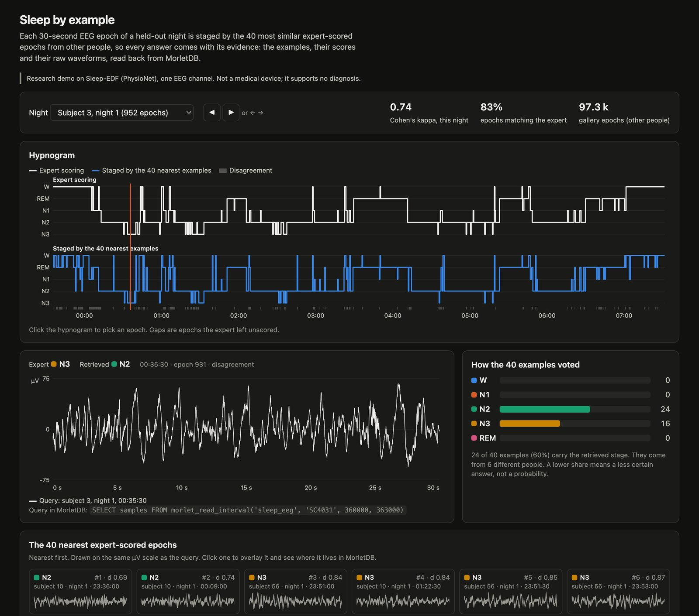

<h1 align="center">Find the signal you have seen before</h1>

<p align="center">
<b>MorletDB is a PostgreSQL extension for waveform archives.</b><br>
Store raw sensor recordings losslessly, select an interval, and ask<br>
<i>“Where else does something like this occur?”</i> — every answer is a recording and a sample interval you can read back.
</p>

<p align="center">
<a href="LICENSE"></a>
<a href="https://github.com/merkhet-io/morletdb/actions/workflows/rust.yml"></a>


</p>

<p align="center">
<a href="#install">Install</a> · <a href="#use">Use</a> · <a href="#research">Research</a> · <a href="#explore">Explore</a> · <a href="#what-has-been-measured">Evidence</a> · <a href="https://merkhet-io.github.io/morletdb/">Website</a>
</p>

---

## Why MorletDB

**Recordings, not rows.** A recording is one channel with a sample rate, a unit, a
calibration and its acquisition metadata. MorletDB keeps that unit intact inside
PostgreSQL, instead of scattering samples over rows or vectors.

- **Lossless and compact.** Raw samples are coded bit-exactly, often several times
  smaller than general-purpose time-series compression on the same data.
- **Search that tolerates time shifts.** Two occurrences of the same pattern rarely
  line up with a window grid. MorletDB scores similarity over a bounded range of
  shifts, exactly or through a standard vector index.
- **Every hit traces back.** Results are intervals of recordings, with their
  metadata, that read back the original samples.
- **Safe to keep ingesting.** Appends, search representations and index rows commit
  in one transaction; retries are verified, gaps and overlaps are rejected.
- **Plain PostgreSQL.** SQL functions, your roles and row-level security, your
  backups. pgvector is optional.

> [!NOTE]
> **Developer alpha.** The recording workflow is implemented and tested in CI on
> PostgreSQL 17 and 18. Retrieval has been evaluated on public seismic data; usefulness
> for other domains and production operation remain to be established. A similar
> waveform is a lead for an investigation, not a diagnosis.

## How it works


1. **Append** chunks of a recording at their global sample offset.
2. **Build** search representations, such as amplitude envelopes of 4096-sample
   windows, in the same transaction, so new windows are searchable at commit.
3. **Search** with a query interval: exact scoring of every eligible window, or
   approximate candidates from a vector index followed by exact re-ranking.
4. **Read back** each match as the original samples, with its recording metadata.

## Install

**Try it in a container** (Linux amd64; builds a PostgreSQL 17 preview, imports
synthetic data, finds a known interval and reconstructs its matches):

```sh
docker compose run --rm walkthrough
```

**Build from source** with Rust and [pgrx](https://github.com/pgcentralfoundation/pgrx)
(PostgreSQL 17 or 18; on Debian/Ubuntu install `build-essential bison flex
libreadline-dev zlib1g-dev libclang-dev clang pkg-config libssl-dev` first):

```sh
cargo install cargo-pgrx --version 0.16.1 --locked
cargo pgrx init --pg17 download          # or --pg18, or --pg17 /path/to/pg_config
cd extensions/pg_morlet
cargo pgrx install --release --pg-config "$(sed -n 's/^pg17 = "\(.*\)"/\1/p' ~/.pgrx/config.toml)"
```

Then, in your database:

```sql
CREATE EXTENSION pg_morlet;
CREATE EXTENSION vector;   -- optional: only for probe search (pgvector 0.8 or later)
```

Supported versions, CI coverage and local test commands:
[PostgreSQL compatibility](docs/compatibility.md). Upgrading an existing
installation: [existing installations](extensions/pg_morlet/README.md#existing-installations).

## Use

```sql
-- a collection holds recordings, raw chunks and search representations
SELECT morlet_create_stream_collection('public', 'signals');
SELECT morlet_enable_envelopes('signals');

-- one recording = one channel: id, sample rate, channel, unit, metadata
SELECT morlet_start_recording('signals', 'pump-7', 25600, 'accel_x', 'g', '{"asset": "P7"}');

-- append samples at their global offset; repeating an identical append is a no-op
SELECT morlet_append_chunk('signals', 'pump-7', 0,
  ARRAY(SELECT sin(i / 40.0) * (1 + (i / 3000) % 3) FROM generate_series(0, 32767) i));

-- build envelopes (4096-sample windows, stride 2048); call it in the append
-- transaction to make new windows searchable at commit
SELECT morlet_build_envelopes('signals', 'pump-7');

-- where else does samples 8192..12288 occur? exact, shift-tolerant search
SELECT recording_id, start_sample, end_sample, distance
FROM morlet_search_envelope_interval('signals', 'pump-7', 8192, 12288, '{}', 5);

-- read any match back as original samples
SELECT samples FROM morlet_read_interval('signals', 'pump-7', 26624, 30720);

-- progress and backlog per window size
SELECT * FROM morlet_collection_status('signals');
```

For large archives, enable **probe search** (needs pgvector): it finds candidates
through an HNSW index and re-ranks them with the same exact score. It is
approximate in which windows it considers, never in the distances it returns.

```sql
SELECT morlet_enable_envelope_probes('signals', 4096);
SELECT * FROM morlet_search_envelope_probes('signals', 'pump-7', 8192, 12288);
```

The fifth argument of the interval searches is a metadata filter (`'{"asset": "P7"}'`).
Small filtered galleries are routed to exact search automatically. Searches run with
the caller's permissions, including row-level security.

More: [SQL reference](extensions/pg_morlet/README.md) · [search contract](docs/search-contract.md) ·
[recording workflow](docs/recording-workflow.md) · [operations](docs/operations.md) ·
[access control](docs/access-control.md) · [Parquet import](tools/ingest/README.md)

## Research

<table>
<tr>
<td width="62%">

**[MorletDB: Recordings, Not Rows — Lag-Tolerant Waveform Retrieval in PostgreSQL](research/paper/morletdb.pdf)**<br>
Technical report, version 0.10, 2026-11-01. *Not peer reviewed.*

Bounded-lag cross-correlation is the right score when matches may be shifted in
time, but standard vector indexes rank by an unshifted metric. Because each lag term
is an inner product with a shifted copy of the query, a sparse grid of **shifted
probes** into an ordinary pgvector HNSW index, re-ranked with the exact score,
recovers the shift-tolerant top ten.

</td>
<td>

On held-out seismic data (234,622 windows):

- **97.7%** of the exact top ten
- **57 ms** p95, against **740 ms** for the fastest exact path
- zero-lag candidates from the same index: **64–66%**

</td>
</tr>
</table>

What it costs and where it is not shown: a probe table and index of about the size
of the raw data, slower search under filters that exclude a query's neighbours, and
extra write-ahead logging for index maintenance. All retrieval results are seismic;
other signals, diagnostic relevance and long-running operation are not shown.
[Supplement](research/paper/supplement.pdf) · [study overview](research/paper/STUDIES.md) ·
[reproduce the numbers](research/paper/ARTIFACT.md) · [main results](research/paper/README.md#main-numbers)

## Explore

<table>
<tr>
<td width="50%">

**Recording viewer.** A local, read-only page for a recording, its context lanes
(program, block, tool, part), segments and labels; compare a segment with the same
context on other parts, or find similar windows.
[tools/viewer](tools/viewer/README.md)

```sh
python -m pip install -r tools/viewer/requirements.txt
DATABASE_URL=postgresql://... python tools/viewer/demo.py
DATABASE_URL=postgresql://... python tools/viewer/viewer.py
```

</td>
<td>


</td>
</tr>
<tr>
<td>

**Sleep staging by example.** 153 Sleep-EDF nights stored as raw recordings; click an
epoch of a held-out night and see the 40 most similar expert-scored epochs from other
people, each read back from its interval. A research demo, not a medical device.
[examples/sleep](examples/sleep/README.md)

</td>
<td>



</td>
</tr>
</table>

Also: [compare a machine with its own history](docs/context-workflow.md) under the
same operating context · [visual notebook](examples/notebooks/README.md) ·
[Parquet importer](tools/ingest/README.md)

## What has been measured

Every evaluation fixes its protocol before reading the data, runs once, and reports
the result, including negative ones. In short:

- **Held up:** lossless storage (1.2–6× smaller than TimescaleDB compression on the
  same samples), exact and shift-tolerant search, probe search on standard indexes,
  retrieval of labelled examples as explanation, comparison under the same operating
  context, access control.
- **Did not hold up:** Morlet features have not beaten simple FFT band powers on
  bearings, ECG or sleep EEG; no wavelet or filter type has beaten a plain band-pass
  filter for bearing faults; own-history comparison has not warned earlier than a plain
  RMS alarm on run-to-failure bearings.

Every evaluation with its data, baselines, confidence intervals and verdict:
**[docs/evaluations.md](docs/evaluations.md)**.

## Boundaries

Append-only recordings; 1–32,768 samples per chunk; explicit channel and unit; no
resampling, gap interpolation, background extraction worker or cross-channel search.
Exact search scans eligible windows; probe search is approximate and opt-in. Alpha:
no stable API or schema guarantee yet. Details: [support boundaries](SUPPORT.md) ·
[compatibility](docs/compatibility.md) · [numerical contract](docs/morlet-extractor.md).

**The name.** MorletDB honours Jean Morlet and the project's starting hypothesis that
Morlet wavelets would suit search in technical signal archives. The system is not tied
to that transform, and our evaluations have not shown a general advantage for it.

## Repository

| Path | What |
|---|---|
| [extensions/pg_morlet](extensions/pg_morlet) | the PostgreSQL extension: storage, ingestion, interval reads, search |
| [crates/morlet-core](crates/morlet-core) | portable Rust core: codec, envelopes, features, checkpoints |
| [tools](tools) | Parquet import, Python client, recording viewer, independent numerical reference |
| [examples](examples) | sleep staging, notebooks and other worked examples |
| [evaluation](evaluation) · [benchmarks](benchmarks) | frozen evaluations and workload benchmarks |
| [research/paper](research/paper) | the technical report, supplement and reproduction package |

```sh
make test       # Rust core and formatting
make pg-test    # needs a pgrx-managed PostgreSQL
```

[Contributing](CONTRIBUTING.md) · [Development](docs/development.md) · [Support](SUPPORT.md) ·
[Security](SECURITY.md) · [Roadmap](docs/product-roadmap.md) · [Brand assets](assets/brand/README.md)

## License

Copyright 2026 MorletDB contributors. Code, documentation and original brand artwork
are licensed under the [Apache License, Version 2.0](LICENSE). A
[Merkhet](https://github.com/merkhet-io) project.

<p align="center"></p>
