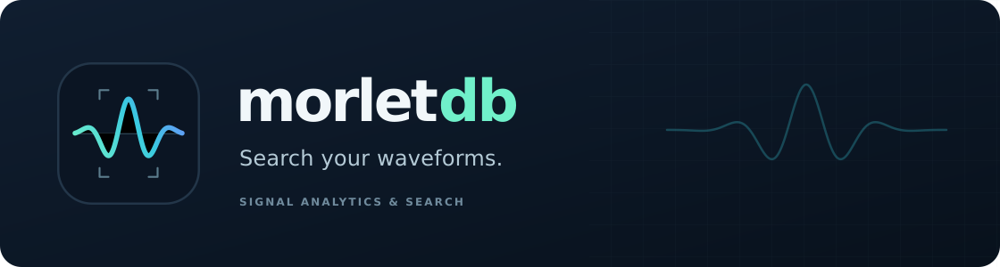

# Signal analytics and waveform search

[](LICENSE)
[](https://github.com/merkhet-io/morletdb/actions/workflows/ci.yml)
[](https://github.com/merkhet-io/morletdb/actions/workflows/rust.yml)

**MorletDB stores waveform recordings and finds similar intervals through their spectral and statistical structure.** Import Parquet, preserve acquisition context, and search with SQL. A [Merkhet](https://github.com/merkhet-io) project, licensed under Apache 2.0.

**Active development follows one Rust/Postgres recording workflow.** The Go app and bounded-recording storage layouts are retained as legacy experiments; see the [architecture decision](docs/architecture.md).

The first application is vibration monitoring. The recording model is domain neutral: uniformly sampled signals, explicit sample coordinates, channel, units and metadata.

> **Early prototype.** Exact search, durable ingestion and recovery are tested. Extraction is synchronous; large-scale retrieval and workload isolation are still under evaluation.

[Architecture](docs/architecture.md) · [Get started](#try-it-in-postgres) · [Import Parquet](tools/ingest/README.md) · [SQL guide](extensions/pg_morlet/README.md) · [Benchmarks](benchmarks/README.md) · [Brand assets](assets/brand/README.md)

## From samples to matches

- **Keep the recording.** Append continuous chunks with global offsets. Windows cross acquisition boundaries, and raw samples remain available alongside metadata.
- **Represent local structure.** Versioned Morlet extraction produces spectral energies, statistical features and localized time/frequency tokens. Normalize each search window independently.
- **Find similar intervals.** Search typed feature vectors with acquisition and metadata filters. Results identify the source recording and exact half-open sample interval.

Durable appends publish raw chunks, newly complete segment features and extraction checkpoints in one transaction. Identical retries are safe, and a fresh connection can resume from committed state. See the [ingestion contract](docs/durable-ingestion.md).

## Try the complete recording workflow

```sh
docker compose run --rm walkthrough
```

This builds the local PostgreSQL 17 preview, imports synthetic Parquet, finds a
known interval and reconstructs matches. See the [walkthrough](docs/recording-workflow.md)
for prerequisites, Python usage, credentials, restart checks and explicit teardown.

## Try it in Postgres

Target: **PostgreSQL 17**. Follow the [Rust/pgrx setup guide](extensions/pg_morlet/README.md#setup) to install the extension, then run:

```sql
CREATE EXTENSION pg_morlet;
SELECT morlet_create_stream_collection('public', 'signals');
SELECT morlet_start_recording(
  'signals', 'motor-001', 4096, 'vibration', 'g', '{"asset":"motor-1"}'
);
SELECT morlet_append_chunk(
  'signals', 'motor-001', 0,
  ARRAY(SELECT sin(i::float8 / 8) FROM generate_series(0,2047) i)
);
SELECT * FROM morlet_search_streams(
  'signals',
  ARRAY(SELECT sin(i::float8 / 8) FROM generate_series(0,511) i),
  4096, 'vibration', 'g', '{"asset":"motor-1"}'
);
```

`morlet_stream_status('signals', 'motor-001')` reports durable progress. The [batched append API](docs/durable-ingestion.md#batched-appends) sends multiple typed chunks per database call with atomic rollback and the same replay checks.

The array search above includes source and overlapping matches. Use `morlet_search_interval` for a stored source interval with source exclusion and overlap suppression, and `morlet_read_interval` to inspect matches. See the [complete workflow](docs/recording-workflow.md).

## Import waveform archives

The [Parquet importer](tools/ingest/README.md) accepts either sample-array rows or individual sample rows. Column mappings are explicit, samples are packed across file-row boundaries, and input can be validated without a database.

```sh
python -m pip install -r tools/ingest/requirements.txt
# Configure DATABASE_URL or the standard PostgreSQL connection environment.
python tools/ingest/parquet_import.py signals.parquet \
  --collection public.signals --rpc-chunks 16 --commit-chunks 32
```

Imports use bounded batches and configurable transactions. Rerunning unchanged input verifies the committed prefix and avoids duplicates. Current sources are local immutable files; the importer does not yet provide S3 discovery or direct row-group resume.

## What a match means

`morlet-energy-v1` represents each window with twelve log-spaced Morlet energy bands plus AC RMS, crest factor and kurtosis. Search compares fifteen log-transformed features using RMS Euclidean distance. Query and stored windows must have compatible rate, channel, unit, length, normalization and extractor version.

Feature similarity is distinct from aligned sample distance. Both primitives are available. The canonical Rust implementation validates the versioned extractor against frozen fixtures from the original Go prototype. Pooled energy features do not preserve event order within a window. See the [numerical contract](docs/morlet-extractor.md).

## Evaluate relevance before scaling

The [real-recording evaluation](evaluation/README.md) compares statistics, FFT,
Morlet and an experimental temporal representation on a small run-separated CWRU
bearing dataset. Morlet ties the statistical baseline in this slice; differentiation
is still unproven. A separate exact-search harness checks larger candidate
populations against an independent ranking oracle.

## Measure before scaling

The [benchmark suite](benchmarks/README.md) separates raw ingest, feature computation and retrieval. It compares JSONB and typed Postgres storage with DuckDB/Parquet using identical features and matching top-k results.

A [long-stream sweep](benchmarks/README.md#continuous-recording-sweep) varies recording length, channel count, chunk size and append batch size, recording throughput, storage/WAL growth, sampled CPU/memory and search latency during writes. CI uploads machine-readable reports. These are reproducible prototype measurements, not production scale claims.

## Current boundaries

| Area | Contract today |
|---|---|
| Continuous recordings | Append-only chunks; bigint global sample coordinates; restartable checkpoints |
| Input | 1..32768 finite samples per chunk; 128..200000 Hz; explicit channel and units |
| Representation | 512..4096-sample windows; versioned extraction and per-window normalization |
| Search | Default exact-search budget: 4096 eligible segments; explicit experiments can raise it to 1,000,000 without a capacity guarantee |
| Consistency | Synchronous extraction and transactional publication; caller permissions and RLS |
| Available | Interval retrieval/inspection, Compose walkthrough and limited real-data relevance baseline |

No resampling, gap interpolation or background extraction worker is implemented. Database-managed stream tables use the supported append APIs; direct mutation can violate cross-table invariants.

## Inside the monorepo

| Path | Role |
|---|---|
| [`crates/morlet-core`](crates/morlet-core) | Portable Rust extraction, chunk boundaries and validated checkpoints |
| [`extensions/pg_morlet`](extensions/pg_morlet) | Postgres storage, SQL primitives, ingestion and exact search |
| [`tools/ingest`](tools/ingest) | Parquet importer and input-contract tests |
| [`benchmarks`](benchmarks) | Reproducible storage, retrieval and streaming comparisons |
| [`apps/server`](apps/server) | Go reference server, HTTP API, CLI and original condition-monitoring demo |

The Rust core stays independent of Postgres. The Go server is a frozen, separate execution/storage path; there is no Go-to-Rust FFI. New product work targets the continuous recording SQL API. Bounded-recording and alternate storage layouts remain experimental.

## Develop

```sh
make test  # Rust core; legacy Go checks are opt-in
make pg-test  # configured PostgreSQL/pgrx required
```

The frozen Go demo remains accessible through `make legacy-build` and `./bin/morletdb demo -data ./data`. It does not use the PostgreSQL backend. See the [server guide](apps/server/README.md) and [development notes](docs/development.md).

## Contribute and get support

[Contributing](CONTRIBUTING.md) · [Support boundaries](SUPPORT.md) · [Security](SECURITY.md) · [Releases](docs/releases.md)

## License

Copyright 2026 MorletDB contributors. Code, documentation and original brand artwork in this repository are licensed under the [Apache License, Version 2.0](LICENSE).

