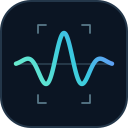

# Find the signal you have seen before

[](LICENSE)
[](https://github.com/merkhet-io/morletdb/actions/workflows/rust.yml)


**MorletDB is a PostgreSQL extension for waveform archives and similarity search.**
Keep raw sensor recordings in Postgres, select an interesting interval, and ask
**“Where else does something like this occur?”** Every match comes back as a
recording and sample interval you can read, plot and trace to its acquisition
context. Built with Rust, PostgreSQL 17 and Python. A
[Merkhet](https://github.com/merkhet-io) project, licensed under Apache 2.0.

> [!NOTE]
> **Developer alpha.** The recording workflow is implemented and tested, and it
> has been exercised on real public seismic data. Real-world usefulness and
> production-scale performance remain to be established. A similar feature
> vector is a lead for investigation, not a diagnosis or a confidence score.

[Quickstart](#quickstart) · [On real data](#on-real-data-seismic-replay) · [What has been measured](#what-has-been-measured) · [SQL guide](extensions/pg_morlet/README.md) · [Visual notebook](examples/notebooks/README.md) · [Architecture](docs/architecture.md) · [Demo ideas](docs/demo-catalog.md)

## How it works


- **Preserve the source.** Append continuous chunks with global sample offsets.
  Raw samples stay authoritative, and search windows can cross chunk boundaries.
- **Search local structure.** Compare versioned spectral and statistical features
  (twelve Morlet energy bands plus RMS, crest factor and kurtosis). Only
  recordings with compatible rate, channel, unit, window and extractor are
  compared, with optional metadata filters.
- **Follow a match back to the waveform.** Results are half-open sample intervals
  with their metadata. Source exclusion and overlap suppression run before top-k.
- **Resume ingestion safely.** Raw chunks, window features and extraction
  checkpoints commit in one transaction. Identical retries are verified, not
  duplicated; changed retries, gaps and overlaps fail explicitly.

A recording is one uniformly sampled channel. MorletDB started with vibration
investigation, and the same model accepts acoustic, electrical and seismic
recordings.

## Quickstart

```sh
docker compose run --rm walkthrough
```

This builds the PostgreSQL 17 preview, imports synthetic Parquet, finds a known
interval and reconstructs its matches. The [walkthrough](docs/recording-workflow.md)
covers prerequisites, the public demo credentials, persistence, restart/replay
checks and teardown. The verified container target is Linux amd64. Tagged images
and exact digests are listed in [releases](docs/releases.md).

Or install the extension with the [Rust/pgrx guide](extensions/pg_morlet/README.md#setup)
and use it directly:

```sql
CREATE EXTENSION pg_morlet;
SELECT morlet_create_stream_collection('public', 'signals');
SELECT morlet_start_recording(
  'signals', 'motor-001', 4096, 'vibration', 'g', '{"asset":"motor-1"}'
);
SELECT morlet_append_chunk(
  'signals', 'motor-001', 0,
  ARRAY(SELECT sin(i::float8 / 8) FROM generate_series(0,2047) i)
);
SELECT * FROM morlet_search_streams(
  'signals',
  ARRAY(SELECT sin(i::float8 / 8) FROM generate_series(0,511) i),
  4096, 'vibration', 'g', '{"asset":"motor-1"}'
);
```

Use `morlet_search_interval` to query an interval already stored in a recording,
`morlet_read_interval` to reconstruct any match, and `morlet_stream_status` to
check committed ingestion progress. See the [recording API](docs/recording-workflow.md).

> [!IMPORTANT]
> Alpha releases ship **no extension upgrade scripts**. Install into a fresh
> database; rebuilding the image does not update an existing database or volume.
> See [existing installations](extensions/pg_morlet/README.md#existing-installations).

## On real data: seismic replay


The [seismic example](examples/seismic/README.md) replays about 900 station-hours
of public broadband recordings from northern Chile (GFZ GEOFON, IPOC network)
through MorletDB. It splits recordings at real data gaps, verifies duplicate and
replayed data, proposes candidate events with an ObsPy STA/LTA baseline, and
retrieves similar historical intervals from the same station in a local Streamlit UI.
USGS catalog events are shown as a separate reference overlay.

What it showed, reported with its limits in the [investigation summary](docs/seismic-investigation.md):

- Durable ingestion held up on real discontinuities: 238 data gaps, retransmitted
  records, and restart or stop-and-resume runs that reproduced results exactly.
- The STA/LTA baseline found all 77 monitored regional catalog arrivals.
  Catalog labels are an incomplete proxy, since most small local events are
  uncataloged.
- Pooled Morlet features retrieved cataloged-event windows far above the base
  rate, and **outperformed or tied** the experimental temporal representation.

It is an investigation tool, not an earthquake classifier or warning service.
Seismic rates use the explicit `morlet-energy-lowrate-v1` representation.

## Import waveform archives

The [Parquet importer](tools/ingest/README.md) accepts sample-array rows or individual
sample rows, explicit column mappings and bounded batches, and can validate
without a database.

```sh
python -m pip install -r tools/ingest/requirements.txt
# Configure DATABASE_URL or standard PostgreSQL connection variables.
python tools/ingest/parquet_import.py signals.parquet \
  --collection public.signals --rpc-chunks 16 --commit-chunks 32
```

Rerunning unchanged input verifies the committed prefix and avoids duplicates.
Sources are local immutable files; S3 discovery and direct row-group resume are
not implemented.

## What has been measured

Every result names its data, baselines and limits. Differentiation from simple
methods has **not** been established.

| Evaluation | Result |
|---|---|
| [CWRU bearings](evaluation/README.md), run-separated | Pooled Morlet **ties** the statistical baseline. A reproducible baseline, not a win. |
| [Seismic replay](evaluation/reports/seismic-cx-north-chile-2024-v2.md), 3 stations, whole-period holdout | Pooled Morlet beats or ties the temporal representation. Catalog precision@5 is 0.21–0.47 against a base rate below 1%. |
| [Wave-index PoC](docs/wave-index-poc.md), synthetic | Temporal cells separate a burst from its time reversal, which pooled features cannot (distance 1.18 vs ≈0). Posting lists traverse most of the index. |
| [Benchmarks](benchmarks/README.md) | Ingestion, extraction and retrieval are measured separately. A 10,000-candidate CI smoke checks ranking against an independent oracle; it is not a capacity claim. |

Reports record parameters and source hashes so they can be rerun; the seismic
report also records the code revision and database it ran on. The wave-index
experiment is in memory, not a PostgreSQL index, and needs a source checkout
rather than a release image; its next steps are in the
[advanced retrieval design](docs/advanced-retrieval.md).

## Where it comes from and where it is going

MorletDB grew out of **condition monitoring with high-volume, high-frequency CNC
spindle data**: vibration across three axes, correlated with temperature and
current. In that work, a vibration episode was most useful when an engineer could
see what the spindle was doing, compare the axes and relate the event to its
operating context. The motivating question was **“Have we seen this pattern
before, and under what conditions?”** Today MorletDB stores and retrieves
single channels. Synchronized analysis across axes, temperature and current is
a development direction, not a current capability.

Next evaluations, all **candidate workloads** rather than demonstrated results:

- **CNC spindle episodes.** A [pilot experiment spec](docs/cnc-spindle-experiment.md)
  with whole-tool holdouts, time-aligned context and reviewed relevance labels.
- **Defense engineering.** Test-and-evaluation and maintenance data: platform and
  subsystem testing, vehicle and support-equipment maintenance, and power-system
  testing. The first proposed slice is a motor or pump test-bench investigation
  with approved data, operating context, difficult negatives and an engineer's
  relevance judgments. None of this establishes defense-specific accuracy or
  deployment readiness.
- **Demo catalog.** Fifteen bounded [investigation ideas](docs/demo-catalog.md),
  covering industrial diagnostics, quality, electrical traces, HDDs, seismic and
  audio, each with data sources, baselines and acceptance criteria.

## Current boundaries

| Area | Contract today |
|---|---|
| Storage | Append-only recordings, raw chunks, typed segments and restartable checkpoints |
| Input | 1..32768 finite samples/chunk; 128..200000 Hz (`morlet-energy-v1`) or opt-in [1,128) Hz (`morlet-energy-lowrate-v1`); explicit channel and units |
| Search windows | 512..4096 samples; compatible rate/channel/unit/window/normalization/extractor |
| PostgreSQL retrieval | Exact scan; default 4096 eligible segments; explicit experiments up to 1,000,000, with no capacity guarantee |
| Consistency and access | Synchronous extraction; transactional publication; caller permissions and RLS |
| Wave-index PoC | Offline temporal scoring and approximate postings; no persistence or SQL integration |
| Lifecycle | Fresh alpha installations; no extension upgrade migration or stable API/schema guarantee |

No resampling, speed invariance, gap interpolation, background extraction worker
or synchronized multichannel retrieval is implemented. Use the supported append
APIs; mutating managed tables directly can violate cross-table invariants.
See [support boundaries](SUPPORT.md) and the [numerical contract](docs/morlet-extractor.md).

## Repository

| Path | Role |
|---|---|
| [crates/morlet-core](crates/morlet-core) | Portable Rust extraction, localized cells, chunk boundaries and checkpoints |
| [extensions/pg_morlet](extensions/pg_morlet) | PostgreSQL storage, ingestion, interval reads and exact search |
| [tools/ingest](tools/ingest) · [tools/client](tools/client) | Parquet import and thin Python recording client |
| [examples/seismic](examples/seismic) | Reference application: seismic replay investigation on public data |
| [examples/notebooks](examples/notebooks) | Visual waveform and match inspection |
| [evaluation](evaluation) · [benchmarks](benchmarks) | Relevance, candidate recall and workload experiments |
| [tools/reference-go](tools/reference-go) | Frozen independent numerical reference; no product runtime |

```sh
make test       # Rust core and formatting; no Go toolchain required
make pg-test    # configured PostgreSQL/pgrx required
```

The Rust core is independent of PostgreSQL. Go is kept only for optional
reference checks (`make test-reference`) and deliberate fixture maintenance
(`make golden`).

[Contributing](CONTRIBUTING.md) · [Development](docs/development.md) · [Support](SUPPORT.md) · [Security](SECURITY.md) · [Roadmap](docs/product-roadmap.md) · [Brand assets](assets/brand/README.md)

## License

Copyright 2026 MorletDB contributors. Code, documentation and original brand
artwork are licensed under the [Apache License, Version 2.0](LICENSE).

<p align="center"></p>
