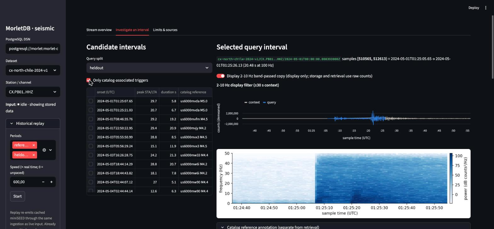
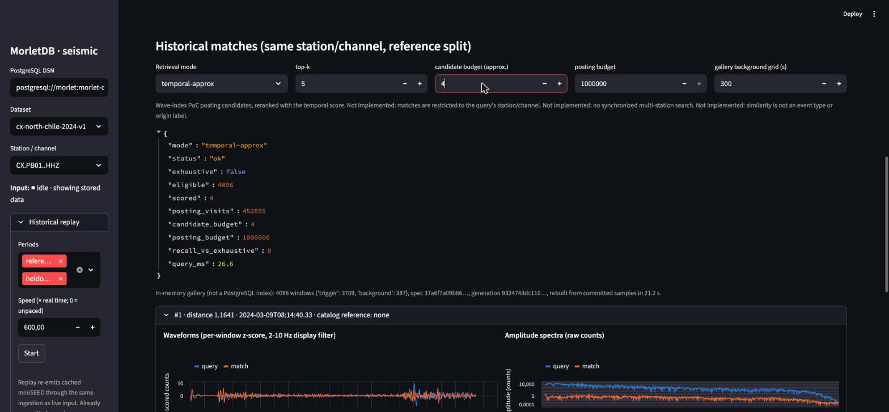

# Seismic replay investigation: results and decisions

Status: **local research application**, historical replay working on real public
data; live SeedLink input implemented but not exercised for the report.
Date: 2026-10-25. Application and launch instructions: [`apps/seismic`](../apps/seismic/README.md).
Full numbers: [`evaluation/reports/seismic-cx-north-chile-2024-v1.md`](../evaluation/reports/seismic-cx-north-chile-2024-v1.md)
(JSON beside it).

This is an investigation tool. Waveform similarity is not an earthquake
classifier, explosion or nuclear-test detector, or warning service, and no
result here validates one.

## What was built

1. **Dataset.** GEOFON FDSN waveforms and StationXML for IPOC CX.PB01, PB02 and
   PB08 `HHZ` (100 Hz STS-2) above the persistent ~100 km deep source region near
   Pica, northern Chile, plus USGS ComCat reference events. Two whole periods:
   a reference week (2024-03-04 to 03-11) and a held-out 5.5 days
   (2024-05-01 to 05-06 12:00). 39 day files, 311 MB, checksummed in a committed
   manifest; replay, detection, retrieval, evaluation and the UI then run offline.
2. **Representation.** `morlet-energy-lowrate-v1`: the v1 transform over the
   disjoint domain [1,128) Hz, opt-in at recording creation, recorded in the
   checkpoint and enforced at every boundary (Rust core, SQL, importer,
   wave-index spec, app). v1 behaviour and frozen fixtures are unchanged.
   Window 2048 samples (20.48 s), stride 512, per-window z-score, bands 1.56-40 Hz.
3. **Ingestion.** One `Chunk` interface for replay and SeedLink; one ingestor
   writing MorletDB recordings via the existing durable append API. Gaps and
   conflicting overlaps split recordings; identical overlaps are verified
   duplicates; samples, extraction checkpoints, progress and discontinuity
   events commit together.
4. **Detection.** ObsPy recursive STA/LTA baseline on a 2-10 Hz copy of
   committed samples, in fixed blocks so results are independent of chunking
   and restarts.
5. **Retrieval.** MorletDB exact pooled search over all reference windows;
   pooled, exhaustive-temporal and approximate-temporal modes of the wave-index
   PoC over a bounded in-memory gallery reconstructed from MorletDB samples.
6. **UI.** Streamlit on 127.0.0.1: replay controls and input-mode indicator,
   UTC timelines of recordings/triggers/catalog arrivals, discontinuity log,
   waveform and spectrogram, ranked matches with waveform/spectrum comparison
   and provenance, separate catalog annotations.






## Measured results (Apple M5 Max, macOS 27, PostgreSQL 17.6 container, arm64)

**Ingestion.** 900 station-hours (324 M samples), 0.92 GB of chunk storage and
631,865 feature windows. PB08 became 240 recordings: 238 genuine in-period gaps
(0.01-4.02 s) plus the reference/held-out boundary; its backward timing jumps carried identical retransmitted samples
and were verified as duplicates (9,258 samples), so no conflicts occurred. An
interrupted PB01 run (300 chunks) followed by a full replay re-appended nothing:
907,165 duplicate samples were verified (900,000 restart prefix plus day-file
overlaps). Three parallel unpaced replays took 22-32 min (560-830x real time
per stream; the read-path fix below was applied mid-run, so this mixes slow-read
and fast-read phases); append batches of 16 x 30 s chunks had p50 0.37-0.38 s and p90
0.66-0.70 s, including synchronous Rust extraction. A per-window
`morlet_features` round trip from Python (including transfer of 2048 floats)
measured p50 31 ms, p90 72 ms. No queue exists in replay; live backlog,
reconnects and freshness are reported by the SeedLink source but were not
measured here.

**Detection.** 14,197 triggers in 892 monitored station-hours. Episodes
(triggers less than 25 s apart grouped) not associated with any cataloged event:
14-16/h at PB01 and PB02, 5.6/h at PB08 (higher noise station, fewer weak
detections). Many are visibly local earthquakes with P/S pairs 11-17 s apart;
ComCat is incomplete below about M3.5 here, so unmatched is not false. All 77
monitored regional catalog arrivals were detected; onset minus IASP91 P had
median 0.48 s and maximum 2.0 s. All 9 teleseismic M6+ arrivals were missed:
the 2-10 Hz band is the wrong band for them. Four catalog arrivals fell outside
recorded or monitored time and are reported, not counted.

**Retrieval.** Queries are held-out detector episodes (all 37 catalog-associated
across stations, plus 60 evenly spaced unassociated per station). Galleries are
reference-only, checked by assertion. Catalog-relevant precision@5 (match overlaps
a cataloged event's predicted arrival window at the same station):

| Station | Base rate in gallery | MorletDB pooled (all 118k windows) | Pooled, gallery | Temporal, gallery | Temporal approx. (64) |
|---|---:|---:|---:|---:|---:|
| PB01 | 29/4096 | 0.37 | 0.47 | 0.24 | 0.21 |
| PB02 | 30/4096 | 0.24 | 0.29 | 0.11 | 0.04 |
| PB08 | 30/3241 | 0.39 | 0.21 | 0.21 | 0.19 |

Pooled features retrieve cataloged-event windows far above the base rate.
**The temporal representation did not beat pooled features**: it was worse at
PB01 and PB02 and equal at PB08. For unassociated queries, both modes find
essentially no cataloged windows (expected; no relevance label exists for them),
and pooled and temporal tie on 59 of 60 queries per station. The same-source
criterion (matched event within 50 km and 30 km depth of the query's event) was
met for only 0-29% of associated queries. Per-window z-scoring removes amplitude
by design, so an M5.0 query can match a much weaker uncataloged event.

**Approximate postings.** Each query visited 208k-690k of 603k-762k posting
entries (common quiet cells), and candidate recall against the exhaustive
temporal top-5 was 0.20-0.64 at 64 candidates and 0.54-0.81 at 1024. On this
data the posting plan is neither cheap nor accurate; exhaustive scoring of a
4096-window gallery took about 0.1 s in Python.

## Defects found and fixed while doing this

- `morlet_read_interval` scanned and detoasted every earlier chunk of a recording
  (0.3-0.5 s per read deep into a 7-day recording). An implied lower bound now
  limits the index range (about 10 ms); a test covers the maximal-chunk boundary.
  The running demo database was patched with `CREATE OR REPLACE`; new installs
  get it from the image. This affects any long continuous MorletDB recording.
- Ending one stream's replay closed other streams' open recordings for the
  detector, leaving about 19 h of PB01/PB02 unanalyzed during the parallel run.
  Fixed, tested, and re-detected from committed samples; PB08's 2,179
  streaming-run triggers were reproduced exactly by the batch re-run.

## Unsupported capabilities

- Event classification of any kind (earthquake/explosion/nuclear), magnitudes,
  locations, phase picking or alerts.
- Cross-station or cross-channel retrieval, synchronized multi-station
  association, three-component (HHN/HHE) analysis. Orientation is recorded but unused.
- Instrument-response removal; physical units. Comparisons are within one
  channel's raw counts.
- Frequency content below about 1.5 Hz at 100 Hz (teleseismic, long period).
- Persistent or incremental temporal index; the gallery is rebuilt in memory
  (about 21 s for 4096 windows) and capped at 4096 windows.
- Upgrade path for existing extension installs (fresh install or manual
  function replacement only).
- Live-mode validation: SeedLink code paths (reconnect, freshness, backlog)
  are implemented but were not run against the server for this report.
- Analyst-reviewed relevance labels: none were created. Catalog-derived labels
  are incomplete and carry arrival-time uncertainty.
- Display-only filtering of short match windows shows a filter startup transient.

## Historical explosion track

Not started. It is optional and was deliberately left until the earthquake
replay worked. A defensible version needs a cited authoritative event list (for
example an official announcement or peer-reviewed catalog) and stations with
public waveforms that recorded both the reference explosion and comparable
earthquakes. It would be shown only as a "historical reference event" overlay.
Separating source types needs specialist validation and additional evidence
such as depth, first-motion polarity and spectral ratios, not similarity scores.

## Next decisions

1. **Temporal representation.** On this real data it did not beat pooled
   features. Decide whether to invest in a different temporal design (for
   example lag-tolerant alignment or coarser time bins) or drop temporal
   retrieval from the near-term roadmap. Do not build persistent wave-token
   indexes on the current cell layout: postings visit most of the index.
2. **Labels.** Commission a small analyst-reviewed relevance set, including
   uncataloged events and negatives, before tuning anything; the catalog labels
   cannot measure precision on most triggers.
3. **Amplitude.** Decide whether z-score normalization is right for seismic
   investigation, or whether an amplitude feature should be retained (a new
   representation version).
4. **Read path.** Ship the `morlet_read_interval` bound with an upgrade script;
   long recordings in any domain depend on it.
5. **Live mode.** Run a supervised SeedLink session to measure freshness, backlog
   and reconnect behaviour before calling live input supported.
6. **Multi-component and multi-station.** Only after single-channel retrieval
   shows value with reviewed labels.

## Reproduce

```sh
docker compose -f apps/seismic/compose.yaml up -d --wait db
cd apps/seismic
../../.venv-seismic/bin/python -m morlet_seismic download    # once, network
../../.venv-seismic/bin/python -m morlet_seismic verify
for s in PB01 PB02 PB08; do
  ../../.venv-seismic/bin/python -m morlet_seismic replay --streams CX.$s..HHZ \
    --output ../../data/seismic/runs/replay-$s.json &
done; wait
../../.venv-seismic/bin/python -m morlet_seismic evaluate --replay-reports ../../data/seismic/runs \
  --output ../../evaluation/reports/seismic-cx-north-chile-2024-v1.json
```

Timings depend on hardware and on concurrent load; trigger counts, segments,
duplicates, catalog associations and retrieval rankings are deterministic for
a given manifest and code version.
