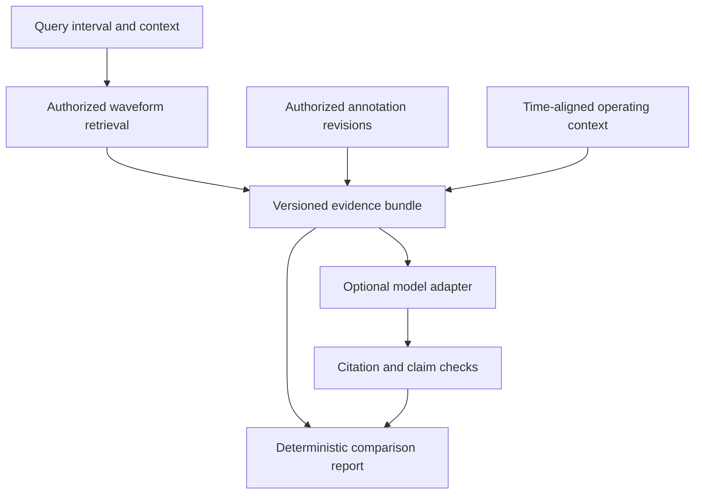

# Wave-RAG: waveform retrieval with inspectable evidence

Status: **proposed**, not implemented. Updated: 2026-10-25.
Implementation targets the continuous-recording SQL API; this is not an
announcement of an available RAG feature or a new storage engine.

## Product direction

An engineer selects a spindle vibration episode and asks: **"Where have we seen
similar behavior, under comparable operating conditions, and what did reviewers
record about those episodes?"**

MorletDB should retrieve original waveform intervals, connect them to versioned
notes and operating context, and export bounded evidence that a human or model
can inspect. The database owns evidence identity, retrieval contracts and access.
An application owns language generation. The first useful deliverable works
without a model: a cited comparison report with links back to source samples.

Wave-RAG is the development direction. Describe implemented milestones precisely;
do not present this proposal as an already supported capability.

## Starting point and evidence

| Available on main | Still missing |
|---|---|
| Append-only single-channel recordings, raw chunks and interval reads | Canonical interval annotations and revision semantics |
| Exact pooled-feature SQL search, metadata filters, source exclusion and overlap suppression | Evidence export with durable identities and explicit completeness |
| Rust extraction with versioned normal and low-rate domains | General representation specifications and published generations (advanced retrieval A1) |
| Python client, notebook and public-data seismic replay example | Grounded-answer application and reviewed answer-quality evaluation |
| Offline exhaustive temporal scorer and approximate postings experiment | Persistent temporal index, synchronized channels and cross-modal search |

The seismic reference evaluation found pooled features better than or equal to
the current temporal score on the measured galleries. Approximate postings visited
many entries and had incomplete recall. Keep exact pooled search as the first
evidence retriever; do not make a persisted wave-token index a prerequisite.
See [seismic results](seismic-investigation.md), [advanced retrieval](advanced-retrieval.md)
and the [CNC pilot](cnc-spindle-experiment.md).

## Three distinct capabilities

1. **Waveform to evidence:** query by example, retrieve compatible intervals and
   attach observations. M1-M2 below.
2. **Evidence to answer:** summarize retrieved evidence with verifiable citations.
   Optional application, M3.
3. **Text to waveform:** queries such as "find chatter" require reviewed concepts,
   annotation search or evaluated cross-modal encoders. Future experiment, not
   supplied by today's energy features.

An embedding, wave token or language model does not turn similarity into a fault
label. Historical reports can be quoted as attributed observations; the application
must not convert those reports into a diagnosis of the query.

## Architecture and ownership

Keep numerical extraction in Rust, storage and authorization in PostgreSQL, and
thin export/report tooling in Python. No provider SDK, network request or LLM
execution belongs in the extension.

## M1: interval knowledge in PostgreSQL

Proposed logical fields (not executable DDL):

| Field group | Contract |
|---|---|
| Identity | Collection identity, recording ID, immutable annotation revision ID, logical annotation ID |
| Target | Half-open sample interval, or explicitly whole-recording scope; recording is required |
| Content | Kind, UTF-8 body bounded to 8 KiB, source/author and optional source URI |
| Provenance | Creation time, effective time if known, schema version and content digest |
| Review | Draft/reviewed/rejected state, reviewer identity and review timestamp when applicable |
| Revision | Prior revision reference; corrections and retractions append revisions |

Review state is part of a revision, not a mutable flag that silently changes an
old citation. Serialize revision creation and reject branches, cycles, cross-recording
supersession and dangling predecessors. Default reads select the active,
non-retracted revision in the caller's snapshot. Explicit historical reads resolve
the cited revision and show whether it has since been corrected or retracted.

Validate bounded intervals against committed samples at insert. An interval ending
exactly where another begins does not overlap it. Whole-recording scope is explicit;
it applies to future appends and bundles must show the source extent actually seen.
Require authorized annotation writes; a caller cannot self-assert reviewer authority
merely by supplying a reviewer name. Define review grants separately from read access.

Annotations must not reveal a recording the caller cannot read. Use caller permissions
and parent-recording RLS throughout; table grants, direct SELECT, insert, revision
lookup and joins must be tested with ordinary roles. Do not treat knowing an evidence
ID as permission. Start with parent-derived visibility; independently restricted
maintenance reports need additional access rules before ingestion.

Bodies, metadata and linked documents are untrusted data. The database never fetches
source URIs. Annotations do not change the numeric waveform ranking in M1-M2.

Proposed API names, subject to implementation review:
`morlet_create_annotation_table`, `morlet_annotate`,
`morlet_annotations_for_interval`. Ship SQL with the explicit alpha fresh-install
requirement; replacing a library does not upgrade an existing database.

## M2: bounded evidence export

Start with exact `morlet_search_interval` and a thin Python exporter. Add a SQL
search-and-annotation function only where it simplifies a shared authorization or
snapshot contract. Avoid a second ranking implementation.

A bundle contains:

- Schema version and content digest; creation time; caller-supplied request ID.
- Query collection/recording/interval, raw interval digest, representation and
  normalization, window, rate, channel, units and any context filter.
- Exact versus approximate plan, eligible/scored counts, top-k, source-exclusion
  and overlap policies, resource budgets and explicit completion status.
- Per match: rank, distance and metric, durable interval identity, raw digest,
  acquisition metadata and exact annotation revision IDs and bodies.
- Optional context spans with clock mapping, offset/drift uncertainty, source
  digests, summary method and missingness. Never invent UTC when the recording
  has no absolute acquisition timestamp.

A durable evidence identity includes collection identity, recording identity,
half-open coordinates and the referenced content/specification digest. Short labels
such as E3 and A7 are aliases local to one bundle, not globally stable IDs.
Define canonical serialization, digest algorithm and raw-sample byte encoding;
normalize encoding details such as endianness explicitly. Do not conflate raw
identity with per-window normalized features.

Build search, sample-digest reads and annotation reads in one bounded read-only
REPEATABLE READ transaction, so concurrent appends or annotation revisions cannot
mix snapshots. A database snapshot identifier or timestamp alone cannot recreate
a historical result after that transaction ends. Persist the bounded bundle and
its exact revision/interval references when reproducibility is required. Future
generations from A1 provide stronger lineage; do not pretend they exist today.

Bound top-k, candidate population, metadata bytes, annotations per match, total
annotation bytes and overall serialized bundle size. Never silently omit over-budget
evidence: return an explicit failure without an answer-ready partial bundle.
Represent missing or unreviewed knowledge as an explicit evidence state.

Raw arrays are read on demand through the authorized interval API, rather than
included in the model prompt. Deterministic descriptors must name their algorithm,
units and normalization; no new descriptor is implied to exist in Rust already.

Exported bundles are copies: later database permission revocation cannot revoke
a downloaded file. Access checks apply at creation and re-resolution; applications
must handle export retention, sharing, deletion and audit. Offline historical
reproduction is bounded by retained source data and export policy.

## M3: optional grounded-answer example

Use a provider-neutral adapter with a deterministic report renderer and a fake
model for CI. Configure a provider/model explicitly for an opt-in live run; record
the exact model ID, settings, prompt version and adapter version. Verify SDK and
citation capabilities against that provider's documentation when implementing;
no model release or provider-specific API is a database dependency.

The example accepts an interval and a bounded question about retrieved history.
It emits statements, citation references and an explicit answer/abstention status.
It distinguishes measured descriptors, reviewed observations, drafts and catalog
references. It does not infer fault cause, event origin, failure probability or
equipment actions.

Validate every citation against bundle-local aliases and immutable evidence
references. Citation existence checks do not establish that a statement is supported.
Display deterministic measurements separately, flag unsupported narrative, and
evaluate claim support with reviewers. Treat annotation text as quoted evidence,
never instructions; test adversarial notes that request tool calls, secret disclosure
or fabricated conclusions. The summarizer has no equipment-control tools.

No relevant-looking match is automatically accepted. Distance thresholds are
representation/domain-specific and require training/calibration data; do not pick
them from held-out results. Distinguish no matches, budget failure, no reviewed
knowledge, model failure and insufficient evidence. Similarity-only evidence can
still produce a deterministic comparison, without a semantic claim.

Network generation is off by default. Use synthetic or approved public annotations
first. Partner waveform context and notes may leave the machine only under an
explicitly approved data policy. A local adapter can be evaluated later through
the same interface.

## M4: evaluate utility and trust separately

Use the CNC spec when its dataset, clocks, labels, reviewers and permissions are
confirmed. Seismic catalog associations are weak-proxy smoke evidence only.
Synthetic tests establish contracts, not industrial relevance.

- Retrieval: reviewed precision/nDCG and first-relevant rank; compare statistics,
  FFT and pooled Morlet on identical eligible populations and context policies.
- Answering: reviewer-assessed claim support, citation support and coverage,
  unsupported-claim rate, and appropriate abstention on positive and negative cases.
- Ablations: waveform-only comparison, annotations-only, retrieved annotated
  evidence, baseline retrieval and no retrieval.
- Leakage: whole-tool/run holdouts, fixed annotation knowledge cutoff and no
  query labels or later maintenance outcomes injected into the evidence.
- Uncertainty: paired results and group-resampled intervals, with independent
  group counts and limitations when too few groups exist.
- Operations: bundle bytes, retrieval/export/generation latency, CPU/memory,
  model token/cost counts and reproducible code/data/prompt provenance.

Agree task-specific thresholds before held-out evaluation. Keep capability gates
distinct: reliable export is an engineering gate; useful grounded investigation
is an application gate; superiority over baselines is a separate differentiation
claim. A small pilot cannot establish universal accuracy.

## Delivery sequence and acceptance

| Slice | Deliverable | Acceptance evidence |
|---|---|---|
| M1 | Annotation/revision SQL plus thin client | Half-open bounds; unauthorized read/write and revision tests; supersession and concurrent-write tests |
| M2a | Exact retrieval plus deterministic evidence export/report | Same hits as existing SQL; stable IDs/digests; bounded consistent snapshot under appends/revisions; explicit budget errors |
| M2b | Export provenance and authorized citation resolver | Reproduce an archived report; detect changed/missing/retracted evidence; no cross-role leakage |
| M3 | Optional answer adapter and citation viewer | Offline fake-model tests, adversarial annotations, unknown citation rejection, distinct failure/abstention states |
| M4 | Reviewed domain pilot and ablations | Per-query results, independent-group counts, supported and unsupported claims, reproducible report |

**Next coding PR: M1 only.** Then M2a with synthetic annotated recordings and the
existing exact search, before model integration. Prefer one end-to-end investigation
over another demo catalog expansion. Estimates depend on reviewed schema and data;
these are dependency gates rather than calendar promises.

## Later database retrieval work

A1 in [advanced retrieval](advanced-retrieval.md) remains the prerequisite for
multiple durable representation generations. After M2, compare annotation/text
retrieval and waveform retrieval separately, then evaluate hybrid rank fusion
and reranking over an identical permission-filtered population. Record constituent
ranks and plan versions; do not add incomparable lexical and waveform distances.

External encoders, learned tokens and text-to-wave queries are optional experiments.
Record model/checkpoint/preprocessing digests and compare against the current exact
baseline before choosing vector or token indexes. The disappointing current temporal
postings result is a reason to measure alternatives, not to reject all temporal
representations or force a new storage engine.

For context, [TimeRAG](https://arxiv.org/abs/2412.16643) and
[TS-RAG](https://arxiv.org/abs/2503.07649) study retrieval-augmented forecasting.
They are adjacent research, not evidence that MorletDB has forecasting or grounded
explanation capability. This proposal prioritizes inspectable historical evidence;
forecasting remains a separate task with its own evaluation.

## Decisions for implementation review

1. Canonical collection identity, annotation revision schema and review grants.
2. Retention/retraction and historical export policy.
3. Bundle schema, canonical sample encoding and digest costs.
4. First approved annotation source and relevance reviewers.
5. Provider adapter and data policy only when M3 is reached.
