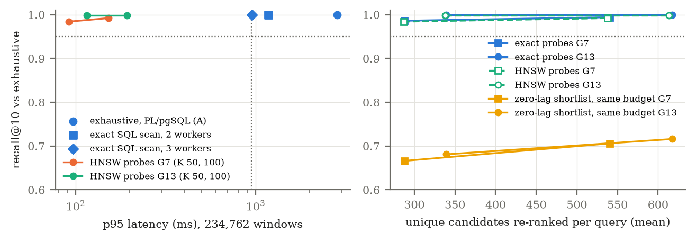

# BL1 Stage A results: shifted inner-product probes recover the bounded-lag top ten at 1/25 of the exhaustive latency — CONTINUE (development evidence only)

Run once on 2026-10-31 as frozen in [PROTOCOL.md](PROTOCOL.md):
- protocol a5381d7, harness and tests 0287ee6, both before measuring;
- **Amendment 1** (d3249b5): the exact SQL baselines were re-timed because the first run had
  measured a serial generic plan for them (see "Deviations"). The first-run timings are
  kept in `results/bl1.json` as `X2_generic` / `X8_generic`.

**Development data, not a confirmation.** R2's database (CX, 4 stations, 1–14 March 2025,
234,762 windows), R2's 100 queries, already consumed by R2 and R2-D.

## Verdict: CONTINUE

All four HNSW probe configurations met every gate condition. The best, **P-G13-50**
(13 probes at lags −30, −25, …, 30; 50 candidates per probe):

| | Exhaustive (A) | Best exact scan (X8, 3 workers) | **P-G13-50** |
|---|---|---|---|
| Mean recall@10 | 1 | 1 | **0.998** (98 queries 1.0, 2 queries 0.9) |
| p50 / p95 latency | 2,816 / 2,835 ms | 877 / 954 ms | **99 / 115 ms** |
| p95 speed-up vs A | — | 3.0× | **24.6×** |
| Unique candidates re-ranked | 234,762 | 234,762 | 338 mean, 391 p95 |
| Added storage | — | — | 515 MB = **1.39×** raw chunk table (budget 1.5×) |

The faster exact scan narrowly missed its own 3× bar (954 ms against 945 ms), so "exact
kernel wins" does not apply. It is still the honest second-best: exact, no extra storage,
three times faster than today's PL/pgSQL path.

## All arms

| Arm | Recall@10 (mean / min) | Candidates (mean) | p95 ms |
|---|---|---|---|
| A exhaustive (PL/pgSQL) | 1 / 1 | all | 2,835 |
| X2 exact SQL, 2 workers | 1 / 1 | all | 1,173 |
| X8 exact SQL, 3 workers launched | 1 / 1 | all | 954 |
| P-G7-50 | 0.984 / 0.7 | 287 | 92 |
| P-G7-100 | 0.992 / 0.8 | 538 | 152 |
| P-G13-50 | 0.998 / 0.9 | 338 | 115 |
| P-G13-100 | 0.998 / 0.9 | 614 | 192 |
| PX-G7-50 (exact probes) | 0.986 / 0.7 | 287 | offline |
| PX-G13-50 (exact probes) | **1.000** / 1.0 | 339 | offline |
| PX-G61-50 (all lags, exact) | **1.000** / 1.0 | 369 | offline |
| EZ, zero-lag, same budget as PX-G13-50 | **0.681** / 0.0 | 339 | offline |
| EZ, same budget as PX-G13-100 | 0.716 / 0.1 | 617 | offline |

**Recall by the lag at which each exact top-ten item scores best** (1,000 items: 499 at
|l| ≤ 5, 266 at 6–15, 235 at 16–30):

| Arm | 0–5 | 6–15 | 16–30 |
|---|---|---|---|
| P-G13-50 | 0.998 | 0.996 | 1.000 |
| PX-G13-50 | 1.000 | 1.000 | 1.000 |
| EZ, same budget | 0.994 | 0.677 | **0.021** |

**By query type** (P-G13-50): random 1.000, high-energy 0.996. P-G7-50's misses are all on
high-energy queries (0.968).



## What the controls establish

- **The descriptor works, not the budget.** At an equal number of candidates (339 per
  query), exact zero-lag shortlisting recovers 0.68 of the top ten, and only 2% of items
  whose best lag is beyond ±15. Exact shifted probes recover 1.000. Half the top-ten items
  (501 of 1,000) sit at |l| > 5; those are the ones zero-lag search loses.
- **ANN costs little here.** HNSW probes (P) against exact probes (PX) at the same grid and K:
  −0.002 (G7-50), −0.002 (G13-50), −0.002 (G13-100), −0.002 (G7-100) recall.
- **Grid spacing matters more than K.** G7 (spacing 10) loses 0.6–1.4 points with exact probes; G13 (spacing 5)
  loses none with exact probes. Doubling K adds candidates and latency but no recall at G13.
- **The bound holds on real data.** PX-G61 (all 61 lags, exact) has recall 1.000, as the
  protocol's argument predicts.
- **Exclusion and suppression** did not cost recall: coverage equals final recall for every
  shortlist arm.
- **A is reproducible:** its 100 lists are identical to R2's tier-3 lists.

## Costs

| Item | Value |
|---|---|
| Raw chunk table | 370.9 MB |
| Envelope table (scorer's input, already present) | 223.3 MB |
| `halfvec` side table (copy of the envelopes) | 240.5 MB |
| Inner-product HNSW index (new) | 274.8 MB; built in 54 s |
| Cosine HNSW index from R2 (unused here, could be dropped) | 274.9 MB |

The side table duplicates the envelope table's values; a product version could keep one
representation if the exact scorer read `halfvec`, which would bring the added storage to
the index alone (0.74× raw). Not tested.

Latency for P includes computing the query envelope, one statement with 13 (or 7) index
scans (`UNION ALL`), deduplication in the client, and the in-database exact re-rank.

## Deviations

1. **Exact SQL baselines first timed on a serial plan** (Amendment 1). psycopg prepares a
   repeated statement after 5 executions and PostgreSQL switches to a generic plan after 5
   more; for X that generic plan was serial (2.8 s, the same as A). Re-timed with
   `plan_cache_mode = force_custom_plan`; EXPLAIN ANALYZE shows 2 and 3 workers launched.
   The verdict did not depend on it: P was below both timings.
2. **"X8" ran with 3 workers**: the setting allows 8, the planner chose 3 for this table size.
   Not tuned further.
3. **Family B was not run**, as justified in the protocol (pruning study).

## Limits

- Development data only; selection of grid and K was fixed before the run, but the data
  had already been studied (R2, R2-D). An independent confirmation slice is needed.
- One gallery (all 234,762 windows, no metadata filter), one machine, one client, warm.
  Filtered HNSW search behaves differently (R2-D: the planner chose a sequential scan for
  a 2% filter at K = 1000).
- Static index. Whether recall and latency hold while windows are appended (Stage B) is
  untested.
- Fidelity only; relevance is not measured.

## Implications

- **Product:** shifted probes need nothing new in pg_morlet's scorer. They need an
  inner-product `halfvec` index and query-side probe construction (a few lines of client
  code, `probes.py`). An exact parallel SQL scan already gives 3× on today's path at no storage
  cost; it is the simpler change if 1 s latency is acceptable.
- **Paper (#61):** R2-D's conclusion, "the loss is the zero-lag candidate metric", now has a
  constructive counterpart: probing the lag terms directly removes that loss. It is
  development evidence until confirmed on independent data.

## Next steps (not started)

1. **Stage B** (own protocol): maintain the inner-product index during replayed ingestion;
   measure visibility delay, query latency and recall against the visible snapshot.
2. **Confirmation slice**: after auditing the dataset ledger, new CX station-days or another
   year never read by any study, with G13-50 frozen.
3. The RisingWave ADR stays deferred until Stage B shows what maintenance costs.

## Reproduce

```sh
.venv-seismic/bin/python -I evaluation/bounded_lag/test_bl1.py
MORLET_DSN="host=localhost port=28817 dbname=morlet_r2" \
  .venv-seismic/bin/python -I evaluation/bounded_lag/bl1.py setup evaluation/bounded_lag/results
MORLET_DSN=... .venv-seismic/bin/python -I evaluation/bounded_lag/bl1.py run evaluation/bounded_lag/results
MORLET_DSN=... .venv-seismic/bin/python -I evaluation/bounded_lag/bl1.py xrerun evaluation/bounded_lag/results
.venv-paper/bin/python -I evaluation/bounded_lag/figure.py
```

Requires R2's database (`evaluation/retrieval_scaling/` on PR #61).
