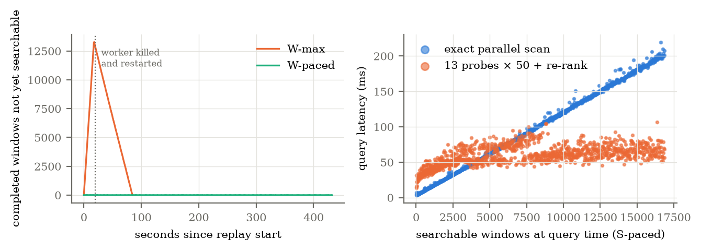

# BL1 Stage B and confirmation: results

## Confirmation (BL1-C) — CONFIRMED

Frozen in [CONFIRMATION.md](CONFIRMATION.md) (cc99d09) before download; harness 6313ec5.
Data: CX HHZ **PB05, PB11, PB14, PB18, 1–14 March 2021** — stations and a year no earlier
study in this repository had read (ledger audit in the protocol). 480.7 M samples, 59
recordings, **234,622 windows**; raw chunk table 514 MB (8.6 bits/sample: these stations
compress less well than R2's). 100 queries by R2's rule (seed 2021).

| | Exhaustive (A) | Exact parallel scan (X8, 3 workers) | **P-G13-50 (frozen)** |
|---|---|---|---|
| Mean recall@10 | 1 | 1 | **0.976** (83 queries 1.0; 12 at 0.9; 3 at 0.8; 2 at 0.7) |
| p50 / p95 | 2,834 / 2,854 ms | 698 / 713 ms | **97 / 131 ms** |
| Speed-up (p95) | — | 4.0× | **21.8×** vs A, 5.4× vs X8 |
| Candidates re-ranked | 234,622 | 234,622 | 357 mean, 456 p95 |
| Added storage | — | — | 515 MB = 1.00× raw (budget 1.5×) |

All four criteria hold. **Weaker than on development data, in one place:** exact probes on
the same grid reach 0.999, so HNSW costs 0.023 recall here (0.002 on R2), concentrated in
high-energy queries (P 0.954, exact probes 0.998; random queries 0.998). The equal-budget
zero-lag control reaches 0.613 and finds none of the 258 top-ten items whose best lag is
beyond ±15. Recall by best lag for P: 0.978 (|l| ≤ 5), 0.973 (6–15), 0.977 (16–30).

## Stage B: maintenance during ingestion — USABLE DURING INGESTION (synchronous recommended)

Frozen in [STAGE_B.md](STAGE_B.md) (ceb63ad), harness 3a171ca; one logged restart (a
serialisation crash before any result was seen). Development data: R2's day-1 recordings
of four stations (34.56 M samples, 16,868 windows), 4 appender threads, 4096-sample chunks.

| Run | Raw append throughput | Processing delay (p50 / p95) | Peak backlog | Queries during ingestion |
|---|---|---|---|---|
| **S-max** (maintenance in the append transaction, unpaced) | **919k samples/s** | 0 (same commit) | 0 | — |
| **W-max** (raw only; one worker, unpaced; worker killed and restarted) | 1.73M samples/s | 33 / 64 s | 13,284 windows; drained 64 s after appends stopped | — |
| **S-paced** (20k samples/s per station, 200× real time) | 80k samples/s (= pace) | 0 | 0 | P p50/p95 60 / 82 ms; exact 88 / 189 ms; recall 0.9997 |
| **W-paced** | 80k samples/s (= pace) | 0.05 / 0.09 s | 8 | P 58 / 82 ms; exact 90 / 191 ms; recall 0.9999 |

- **Completion delay** (chunking + append, paced runs): p95 0.12–0.13 s; it is separate from
  processing delay, which is 0 for S and 0.09 s p95 for W at this pace.
- **Recall** is P-G13-50 against the exact scan in the same `REPEATABLE READ` snapshot
  (1,048 and 1,050 queries); minimum 0.9.
- **Throughput:** S costs 47% of raw-only append throughput at full speed but scales with
  the number of appenders (4 here, about 450 windows/s together); the single W worker
  maintains about 200 windows/s, so it falls behind when raw appends outpace it (W-max)
  and keeps up at 200× real time. Both are far above real time for 4 channels at 100 Hz.
- **Completeness:** in every run every completed window has exactly one envelope and one
  side-table row (checked per recording), including after the worker was killed with
  SIGKILL. The kill landed at 20.0 s, as the appenders finished, so during the backlog
  drain; the restarted worker resumed from the stored envelopes.
- **Drills:** a duplicate replay of a committed chunk changed nothing; a gapped append was
  rejected (`chunk offset must equal the next sample offset (no gaps, overlaps or
  replays)`) with no state change.
- **Memory:** the worker's peak RSS was 55 MB at mid-run and at the end. Extraction state is
  bounded by design: each envelope reads its own window from raw chunks.
- **Bytes:** WAL 103–120 MB per run for 34.6 M samples. Final sizes: raw chunks 26.3 MB,
  envelopes 16.5 MB, side table **including its indexes** 38.2 MB (of which the HNSW index
  19.8 MB). At this small, well-compressing slice the side table and index exceed the raw
  data (1.45×); at 235k windows they were 1.39× (R2) and 1.00× (confirmation).

### Progress and semantics

- *Raw progress* = recording checkpoint; *representation progress* = last stored envelope;
  *index visibility* = side-table row (same transaction as the envelope, so equal).
- S makes a window searchable in the transaction that completes it; W makes it searchable
  within the worker's step. Neither claims exactly-once delivery: idempotent replay plus
  primary keys give at most one row per window, and completeness is checked by counting.
- The append contract rejects gaps and out-of-order input; such input belongs in a staging
  layer (the collector spool), never silently in the archive.

## Limits

- Stage B used development data, one machine, 4 channels and one day per run; no
  concurrent query load in the max runs; one worker.
- The probe query competes with appends on the same machine; latency under heavier
  concurrent workloads is untested.
- HNSW never deletes here; deletion and index rebuild are untested.
