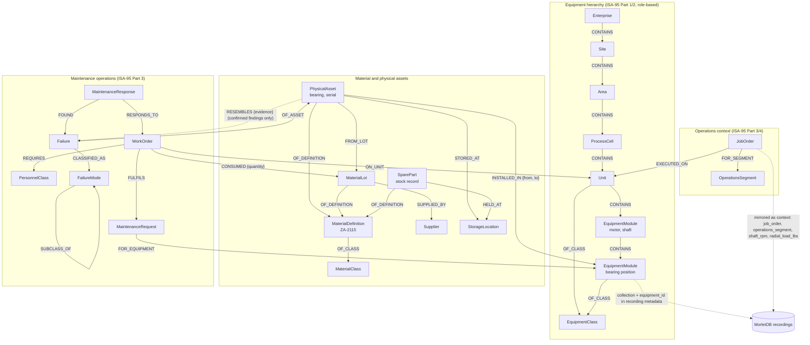

# The plant model

A fictional water utility, structured after ISA-95, whose monitored bearings carry real vibration recordings
(the NASA/IMS bearing run-to-failure data). The organisation, its sites, units, lots, suppliers, work orders and
the mapping of IMS runs onto it are invented; the recordings, their times and the three recorded failures are
the IMS data's. The model is data in [`plant.py`](plant.py); [`load.py`](load.py) writes it to the AGE graph
`plant` and the recordings to the MorletDB collection `fleet.vibration`.

Size: 259 vertices and 555 edges; 16 units, 2 of them monitored; 6,256 recordings.

## Diagram

## Vertex labels

| Label | ISA-95 concept | Here |
|---|---|---|
| `Enterprise` | Enterprise (Part 1 role-based equipment hierarchy) | `AW`, "Aldermere Water (fictional)" |
| `Site` | Site | `AW-N` North works = **Site A**, `AW-S` South works = **Site B** |
| `Area` | Area | two per site: pumping, aeration |
| `ProcessCell` | Process cell (continuous production) | one per area: a pump station or blower hall |
| `Unit` | Unit | 16: pumps `P-101..104`, `P-201..204`, blowers `F-111..114`, `F-211..214` |
| `EquipmentModule` | Equipment module (below the unit; Part 1 allows nesting) | per unit: motor `.MTR`, line shaft `.SHAFT`, and four bearing positions `.BRG-1..4` under the shaft |
| `EquipmentClass` | Equipment class (Part 2) | pump set, blower, motor, shaft, bearing position |
| `MaterialClass` | Material class (Part 2) | rolling-element bearings |
| `MaterialDefinition` | Material definition | `MD-ZA2115`, the Rexnord ZA-2115 double-row bearing named in the IMS readme |
| `MaterialLot` | Material lot | 8 fictional lots, with received date and quantity (bearings of the lot in this graph) |
| `Supplier` | (not an ISA-95 object; a party in the material lot's source) | 2 fictional distributors |
| `PhysicalAsset` | Physical asset (Part 2): the specific bearing with a serial number | 82 bearings: installed, removed, or spare |
| `StorageLocation` | Storage location (material storage, Part 3 inventory) | one stores per site |
| `SparePart` | Material inventory record for one definition at one storage location | on hand, reorder point |
| `MaintenanceRequest` | Maintenance request (Part 3 maintenance operations) | why work was asked for |
| `WorkOrder` | Maintenance work order | corrective or preventive, task, opened, closed |
| `MaintenanceResponse` | Maintenance response | findings, outcome |
| `Failure` | (maintenance information: the failure event the response found) | the three IMS failures, with the readme as `source` and the last snapshot as `evidence_recording_id` |
| `FailureMode` | (maintenance classification) | hierarchy: rolling bearing failure > inner race, outer race, rolling element |
| `PersonnelClass` | Personnel class (Part 2) | reliability engineer, maintenance technician, contract technician; no persons |
| `OperationsSegment` | Operations segment (Part 2/3) | continuous duty at constant speed and load |
| `JobOrder` | Job order (Part 3/4 operations scheduling) | one per IMS run: unit, period, 2,000 rpm, 6,000 lbs |
| `Meta` | none | model version and the plant's present (`now`) |

## Edge types

| Edge | ISA-95 concept | Properties |
|---|---|---|
| `CONTAINS` | the role-based equipment hierarchy (parent contains child) | `site` |
| `OF_CLASS` | equipment / material element belongs to its class | |
| `OF_DEFINITION` | lot, physical asset or stock record is of a material definition | |
| `SUPPLIED_BY` | lot's source | |
| `FROM_LOT` | physical asset was taken from a material lot | |
| `INSTALLED_IN` | the physical asset fills the equipment role (Part 2: physical asset to equipment mapping) | `from`, `to` (half-open, UTC; `to` absent while installed) |
| `STORED_AT` | asset held in a storage location | `from` |
| `HELD_AT` | stock record of a storage location | |
| `FOR_EQUIPMENT` | the request's equipment | |
| `FULFILS`, `RESPONDS_TO` | request, work order, response chain (Part 3) | |
| `ON_UNIT`, `REQUIRES`, `CONSUMED` | work order's unit, personnel class and material consumed | `quantity` on `CONSUMED` |
| `FOUND`, `OF_ASSET`, `CLASSIFIED_AS`, `SUBCLASS_OF` | the response's finding, the failed asset, its mode, the mode hierarchy | |
| `EXECUTED_ON`, `FOR_SEGMENT` | job order's unit and operations segment | |
| `RESEMBLES` | none (an investigation result) | written only by `confirm_finding.py`: finding id, evidence, label and episode ids in MorletDB, who confirmed |

Every vertex and edge has a `site` property: `A`, `B`, or `*` for enterprise-level elements (classes,
definitions, lots, suppliers, failure modes, personnel classes, segments). An edge has the site of its site-scoped
end. The access rule uses only this property (CHECKS.md, check 3).

## Linking the IMS runs

| IMS run (readme) | Unit and site | Positions | Recorded outcome (readme) | In the graph |
|---|---|---|---|---|
| Set 1, Oct 22 – Nov 25 2003, 2,156 files, 8 channels | blower `F-212`, Site B | `BRG-1..4` = bearings 1–4, channels 1, 3, 5, 7 (the first of each bearing's two accelerometers) | inner race defect on bearing 3, roller element defect on bearing 4 | `Failure` FL-2003-11-F212-BRG3 (inner race), FL-2003-11-F212-BRG4 (rolling element); overhaul WO-2003-1126-01 |
| Set 2, Feb 12 – 19 2004, 984 files | pump `P-102`, Site A | `BRG-1..4` = bearings 1–4 | outer race failure on bearing 1 | `Failure` FL-2004-02-P102-BRG1 (outer race); overhaul WO-2004-0219-01 replaced all four bearings |
| Set 3, Mar 4 – Apr 18 2004 as distributed (6,324 files; the readme lists 4,448 ending Apr 4) | the same pump `P-102` with its new LOT-0402 bearings, **running at the plant's present** | `BRG-1..4` = bearings 1–4 | outer race failure on bearing 3 | **not in the graph**: held out |

- **Currently running assets.** The plant's present is 2004-04-17 12:00 (`Meta.now`). P-102's recordings come from
  test 3 up to that time; the rest of test 3 (from 2004-04-17 12:02, including the end of the run) is not loaded, and
  its outcome is not in the graph. The tests check the investigation's answer against it. All other running
  units (14 of 16, including F-212 after its overhaul) have no recordings: their bearings, lots and maintenance
  exist only in the graph.
- **Bearing replacement mid-history.** P-102's positions each held a LOT-0311 bearing from 2004-02-12 09:00 to
  2004-02-19 08:00 (test 2), were empty until 2004-03-04 09:00, and hold a LOT-0402 bearing since (test 3).
  Four other units had one bearing replaced by a LOT-0402 bearing in March–April 2004 (routine work orders).
- **Recordings.** Every 6th IMS file of each run, in name order (one an hour on the 10-minute schedule; the first
  43 files of set 1 were 5 minutes apart), set 3 only before the present: 360, 164 and 1,040 snapshots, four
  recordings each (one per position). A recording is one snapshot of one position: 20,480 samples at 20 kHz, values
  as distributed (0.001 grid, unit not stated), stored exactly.
- **Recording to graph.** Recording metadata carries the ISA-95 `equipment_id` of the position (e.g.
  `P-102.BRG-3`), `site`, `unit`, `start` (rig clock from the file name, shown as UTC) and the IMS provenance
  (`ims_test`, `ims_bearing`, `ims_column`, `source` file). The recording id is `<equipment_id>.<start>`. In the
  graph, monitored positions carry `collection` and `equipment_id`, and both positions and recorded bearings carry
  `first_recording_id` and `last_recording_id`; a failure carries its `evidence_recording_id`. Which bearing a
  recording shows is resolved through `INSTALLED_IN` at the recording's `start`.
- **Operating context.** Each job order is mirrored into MorletDB context on each of its recordings (keys
  `job_order`, `operations_segment`, `shaft_rpm`, `radial_load_lbs` over the whole recording, idempotent batches
  `isa95-<job order>-<n>`, via `morlet_add_context`). The tests check that the graph's job order for every
  recording's unit and time equals its context.

## Simplified, or not ISA-95

- **One rig per unit.** Every unit is modelled like the IMS rig: four bearings on one line shaft, belt-driven by
  a motor, at 2,000 rpm under 6,000 lbs radial load. Real pumps and blowers differ; nothing here depends on it
  except that the recordings fit.
- **Bearing positions as equipment modules.** ISA-95/ISA-88 would put the sensor-level items lower (control
  modules) or model the position as a functional location; one equipment module per position keeps the hop count
  fixed.
- **Physical assets are not material sublots.** A bearing is first material (from a lot) and, once installed, a
  physical asset; the model uses one `PhysicalAsset` vertex for both, with `FROM_LOT`.
- **Failure and FailureMode** are not ISA-95 objects; maintenance information in Part 3 is free-form. The mode
  hierarchy is the three IMS fault types under one parent.
- **No persons, schedules, capability or performance objects**: personnel classes only, no maintenance schedules,
  no KPIs. `Supplier` is a property-like vertex, not a B2MML party.
- **Times** are the IMS rig clock (time zone not stated), shown as UTC, and stored in the graph as ISO strings in
  one fixed format so that string order is time order.
- **Lot quantity and other enterprise-level properties are not filtered**: a Site A role sees that LOT-0402 has 10
  bearings although it can see only the Site A ones.
- **The investigation's "changed" test** is the latest snapshot's RMS against the median of the first 24 snapshots
  after the current bearings went in (at least 2×). It is a fixed rule for the scripted reference, not an
  evaluated detector.
