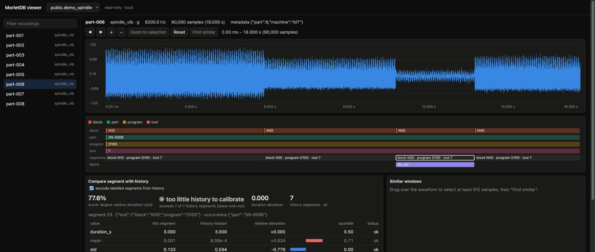

# MorletDB viewer



A local, read-only web page for looking at recordings the way the context workflow
sees them:
- the waveform, with zoom, pan and min/max per pixel computed in the database;
- context, segment and label lanes;
- a click on a segment compares it with history (`morlet_compare_summary` and
  per-value `morlet_compare_to_history`);
- a selected window searches for similar windows (`morlet_search_envelope_interval`);
- per value, where the segment sits in its history (dots: history, bar: this
  segment), and similar other occurrences of the context
  (`morlet_history_neighbors`) with their labels; click one to open it. They are
  for browsing, not diagnosis: their labels describe those occurrences, and in
  [C4](../../evaluation/context/c4/results/RESULTS.md) they named the event worse
  than the machine's last label;
- with `--allow-labels`, label a selection or a segment, or retract a label, from
  the page;
- for recordings in an acquisition, the other channels are drawn under the waveform
  on the same acquisition-time axis. The comparison then also lists every channel
  side by side (`morlet_compare_acquisition`), with options for "history before
  this point only" and "include level (p75) in score".

```sh
python -m pip install -r tools/viewer/requirements.txt
DATABASE_URL=postgresql://user@localhost/db python tools/viewer/viewer.py   # http://127.0.0.1:8765
```

To try it on synthetic data, run `python tools/viewer/demo.py` against a scratch
database first. Unlike the viewer, the demo script writes: it drops and recreates
`demo_spindle*` tables, so use a role and database meant for that. It creates `demo_spindle`: 8 parts with program/block/tool/part
context, an air cut in part 6 (labelled) and chatter in part 7. Each part is an
acquisition with two channels: spindle vibration (5 kHz) and spindle current
(500 Hz, a separately clocked logger, +2 ms ± 1 ms).

## Labels from the page (opt-in)

```sh
DATABASE_URL=postgresql://... python tools/viewer/viewer.py --allow-labels
```

- **Adding a label:** select a range on the waveform (or click a segment), press
  **Label…**, then enter a label and an optional note.
- **Retracting a label:** click it in the labels lane.
- **The only writes:** `morlet_add_label` and `morlet_retract_label`, on a
  separate connection under the caller's role.
- **Why label:** labelled segments can be kept out of history (the default in the
  comparison), and labels are the evaluation sets of the future.

## Safety

- **Local only.** The server binds to 127.0.0.1. It answers only requests
  addressed to `127.0.0.1` or `localhost` on its port (421 otherwise), which
  guards against DNS rebinding.
- **Read-only by default.** Every reading session starts with
  `default_transaction_read_only=on` and a 20 s statement timeout. Without
  `--allow-labels` the server accepts no writes at all.
- **Guarded writes.** With `--allow-labels`, a write must carry a random token
  generated for this run. Only the served page knows it, and sends it as a custom
  header. A write must also be JSON, at most 10 kB, and come from this server's
  origin if the browser sends one. Another website open in the same browser can
  therefore not label or retract anything. It uses the caller's
  role, so permissions and row-level security apply unchanged.
- **Discovered names only.** Collections are accepted only if they are
  discovered stream collections the role can read. All values go through query
  parameters.
- **Self-contained page.** It loads nothing from the network: no CDN, no fonts,
  and a restrictive Content-Security-Policy.

## Reading the comparison

- **Score:** the largest relative deviation over duration, std, crest and
  kurtosis. This is the score evaluated in C2 and C3. Dimmed values are shown but
  do not count.
- **Rank against history:** "exceeds k of n history segments" ranks the score
  against leave-one-out scores of the same context.
  - Status badges ("within history", "elevated", "unusual for this context")
    appear only with at least 20 history segments.
  - Below that, the rank is too coarse: exceeding all of 7 happens by chance one
    time in eight.
- **History excludes labelled segments** by default (checkbox), so a known air
  cut does not become "normal".
- **Tool age.** For gradual wear, time in use tracks nearly as well as sensor
  values (C1). Read scores next to tool age.

## Limits

- Overview requests cover at most 2^22 samples (zoom in for longer recordings).
- One channel at a time; multichannel acquisitions are not implemented yet.
- No editing: labels and context are added through SQL.
